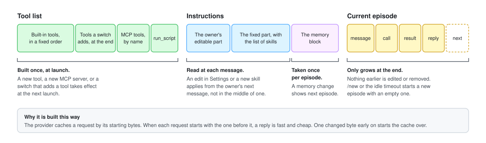

# Architecture

`mac-os-agent` is one text field with two ways to answer it.
The instant path answers without a model: it opens an app or runs a quick action the moment the owner presses Return.
The agent loop answers with a model: it sends the conversation, runs the tools the model asks for, and repeats until the model has nothing more to do.
Every other part either feeds one of those two, shows what they did, or keeps what they need between launches.

[VISION.md](../VISION.md) names three kinds of request. The first is the instant path. The second and third are both the agent loop, with tools or without.

## What a change is judged against

A change fits the structure when it keeps these six things true. Each one protects something in the vision.

1. **The instant path never waits.** It runs on every keystroke, so it reads nothing from the network and nothing slow from disk. It decides from lists read ahead of time.
2. **A request starts with the same bytes as the one before it.** The tool list is built once at launch. The instructions are read once per message. The thread only grows at its end. This is what makes a reply fast, and it is why so many settings say "takes effect at the next launch."
3. **The loop knows no model API and no particular tool.** It sees `ModelProvider` and `AgentTool`. A new provider or a new tool never changes the loop.
4. **A tool reaches the owner only by asking for a go-ahead, and reaches the Mac through a seam.** A tool never draws anything. What it touches on the Mac sits behind a protocol that a test replaces.
5. **Logic lives in the core library. The app target draws and wires.** Anything with a rule in it can be tested without a window.
6. **What the agent keeps is plain files in one folder.** Settings and the agent's own tools change them through the same types, so the two can never disagree about a file's shape.

A change should be resisted when it makes the instant path wait, changes the start of a request in the middle of a run, teaches the loop about one tool or one provider, or puts a rule where only a window can exercise it.

## The parts

| Part | What it owns | Where | What it does not know |
|---|---|---|---|
| **App shell** | Launch, the menu bar icon, the summon shortcut, updates. It builds every other part once and passes each what it needs. | `main.swift`, `AppDelegate.swift`, `SummonTriggerController.swift`, `AppUpdater.swift` | How any part works inside. |
| **Panel** | The text field, the conversation, the tool call inspector, and where the window sits. | `SummonPanel.swift`, `SummonView.swift`, `InputField.swift`, the `Panel*` and `*View` files | The model, the tools, and the files. It draws a session. |
| **Incognito window** | A second panel over a conversation held in memory. | `IncognitoWindow.swift` | Nothing the main panel keeps. It gets its own loop, its own store, and three tools. |
| **Session** | One conversation window's state: what Return does, the running task, the go-ahead card, the queue. | `AgentSession.swift` | How a reply is produced. It calls the loop and listens to its events. |
| **Instant path** | Matching the draft to an app or a quick action, and ranking by what the owner picked before. | `InstantActions/`, `Applications/ApplicationMatcher.swift`, `InstantActionsModel.swift` | The model. |
| **Agent loop** | One instruction from start to finish, and every write to the thread. | `AgentLoop.swift`, `ThreadStore.swift`, `Episodes.swift` | Any provider's API, any tool's purpose, and the window. |
| **Prompt** | The instructions at the head of a request. | `AgentInstructions.swift`, `Skills.swift`, `Memory/MemoryBlock.swift` | The conversation. |
| **Model provider** | Turning a request into one provider's API call and its stream back into events. Sign-in. | `ModelProvider.swift`, `OpenAI/`, `Ollama/` | Tools' behavior and the thread's storage. |
| **Tools** | Everything the agent can do, each as one `AgentTool`. | `AgentTool.swift`, `ToolRegistry.swift`, and a folder per family: `Applications/`, `System/`, `PersonalData/`, `Memory/`, `Themes/`, `QuickActions/`, `WebSearch/`, `ToolGroups/`, `MCP/`, `Scripts/` | The window and the model. |
| **Settings window** | Showing and changing what the agent keeps and how this run is set up. | `SettingsWindow.swift`, the `*Settings.swift` files | Nothing of its own. It uses the same library types the tools use. |
| **What the agent keeps** | The thread, memory, skills, quick actions, themes, MCP files, the usage log, preferences, secrets. | `AgentPaths.swift`, `SecretStorage.swift`, each library type | Who is reading it. |

Paths under **Where** are in `Sources/mac-os-agent/` for the first four rows and the Settings window, and in `Sources/MacOSAgentCore/` for the rest. `InstantActionsModel.swift` is the instant path's one file in the app target.

### Four ways a capability reaches the agent

These are easy to confuse, and each new capability has to pick one.

- **A built-in tool** is in the tool list of every request. It costs the prompt its description and schema every time. Use it for what the agent does often.
- **A tool in a group** is left out of the list. The instructions name the group in one line, and the model reaches the tool through `find_tools` and `use_tool`. Use it for what the agent does rarely. See `ToolGroups/OnDemandTools.swift`.
- **An MCP server's tool** comes from a program the owner listed in `mcp-servers.json`. It joins the list at launch from a cached copy, so launch never waits for a server.
- **A skill** is prose the model reads, in a folder the agent can write to. A **quick action** is data the app runs, with no model. A skill teaches. A quick action repeats.

## What Return does

Three details the picture leaves out:

- A quick action's steps run through the loop's own tool runner (`AgentLoop.runQuickAction`), with every go-ahead already given, since the owner chose the action from a list. So the instant path and the loop share one way of running a tool and one way of writing to the thread.
- The task belongs to the session, not to the window. Hiding the panel does not stop it.
- When a task is stopped, every call the model made still gets a result before the loop returns. The thread is always valid input for the next request.

## What a request is made of

Rule 2 above is the one that shapes the most code, so here is when each thing is read.

| When | What | Why then |
|---|---|---|
| Once, at launch | The tool list: built-in tools, MCP tools from their cache, `run_script`. Which web search is on. The experiments that add a tool or a line to the instructions. | A change would move every byte after it in the request. |
| Once per episode | The memory block at the end of the instructions. | The agent changes memory while it works. The block it started with has to hold for the episode. |
| Once per message | The editable instructions and the list of skills. | An edit should apply soon, and never in the middle of a turn. |
| Every time | Quick actions, themes, the list of apps, Settings switches that only change how the panel behaves. | None of these is in the request. |

A new feature that changes the tool list or the instructions is read at launch. One that does not can be live.

## Where things are kept

| Kept in | What | Rule |
|---|---|---|
| The data folder, `~/Library/Application Support/mac-os-agent/` | The thread and its search index, memory and its journal, skills, quick actions, themes, the MCP files, the usage log, task links, the edited instructions. | Plain files. The thread and the journal are only ever added to. `--data-folder` points a run at another folder. |
| Preferences | The model, the summon shortcut, behaviors, experiments, web search, the active theme, the episode timeout. | Small choices with no content in them. |
| Secrets | The sign-in and API keys. | The Keychain in a release build, `secrets.json` in the data folder otherwise. See `SecretStorage`. Never in the preferences and never logged. |
| Memory only | An incognito conversation, the access token, the message queue, the problem log. | Gone when the window closes or the app quits. |

## Where the code does not match this yet

This section is the point of the exercise. Each item is something the picture above states more cleanly than the code does. None is a bug. Each is a place where the next change has to guess, so each needs a decision: fix the code, or change the picture.

1. **The core library is two things.** It holds the agent (the loop, the tools, the stores) and it holds the panel's rules (`PanelGeometry`, `PanelSlide`, `PanelLayering`, `PaneStack`, `Transcript`, `Markdown`, `CodeHighlighting`, `ToolOutputFormat`, `Themes/`, `SummonTrigger`, `AppIconDrawing`). The rule in use is "can be tested without a window," not "is part of the agent." 48 of its 108 files sit at the top level with no folder to say which they are.
2. **The session holds rules, and it is in the app target.** `AgentSession.swift` is 1,031 lines. It decides what Return does, runs quick actions, keeps the queue, and writes the status lines after a task. By rule 5 those belong in the core library. It also carries about 8 properties that exist only for previews.
3. **One provider does three jobs.** `ModelProvider` is the seam, and `OpenAIResponsesProvider` is the only type behind it. It sends to OpenAI, to Ollama, and through inference-gateway, choosing by the model's id and the build. `Ollama/` holds a model list and no provider. `ModelAccess`, which is about every provider, is in `OpenAI/InferenceGateway.swift`.
4. **"Built once and passed in" has holes.** Preferences are read through statics in 9 core files, such as `Experiment.scripts.isOn()` and `ModelSetting.effective()`, from wherever the value is wanted. `EventKitStore.shared`, `ThemeModel.shared`, and `KeepOnTopSetting.shared` are reached directly.
5. **"Read at launch" is a habit, not a type.** Each feature that must be fixed for the run says so in a comment and captures its own value: `WebSearchContext(launched:)`, `AgentPrompt.taskLinks`, `experimentsOnAtLaunch`. Nothing holds "this run's setup" in one place, so nothing stops the next feature from reading its switch live and breaking rule 2.
6. **Incognito is a second set of parts and also a flag.** The loop, store, tools, and instructions are separate objects, which is the clean half. The session and the views also branch on `isIncognito` in 6 files.
7. **The loop knows two things that are not the loop.** `runQuickAction` and `logAppOpening` are extensions on `AgentLoop`, in `QuickActions/` and `InstantActions/`. They are there because the loop is the only thing allowed to write to the thread and run a tool. That suggests a smaller part inside the loop, "write to the thread and run a tool," which the loop and the instant path would both use.
8. **Preview code lives beside the code it previews.** `PanelPreview.swift` and four more preview files are in the app target, and `main.swift` spends most of its length on preview arguments.

## Keeping this true

This file describes the top level only. It should change when a part is added, removed, or given a new job, and not otherwise. `planning/decided.md` records how each feature behaves.

The diagrams are hand-written SVG in `docs/architecture/`. Edit the file, then look at it before committing. `qlmanage -t -s 1400 -o <folder> <file.svg>` draws one to a PNG without opening a window.
